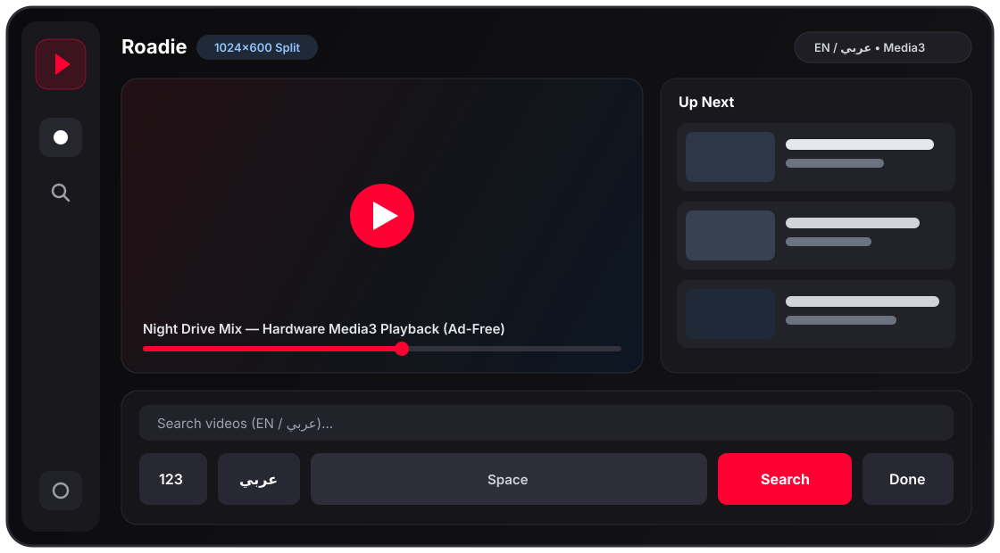
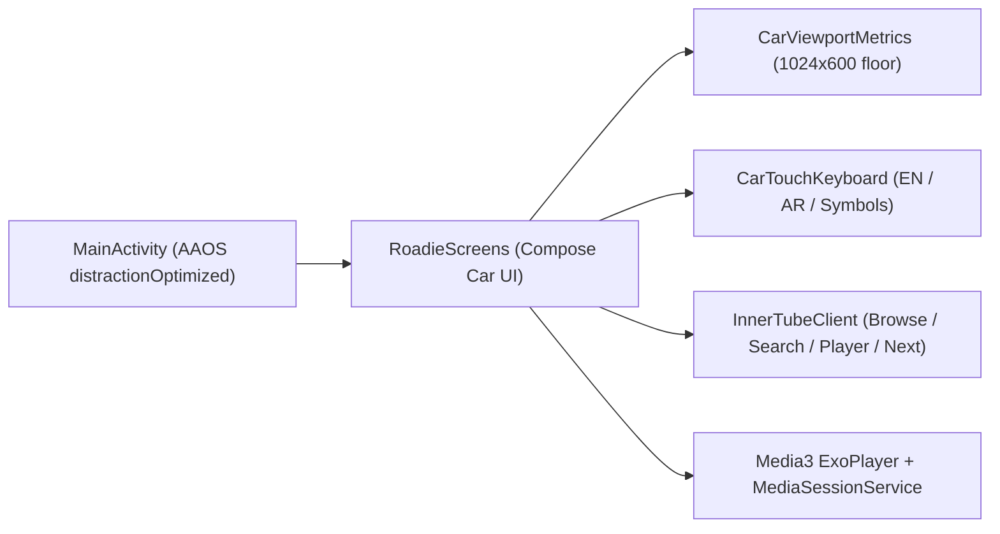

<div align="center">


# Roadie: Native YouTube for Android Cars

### One clean-room Android app for Android Automotive OS and Android car head units.

**No root. No APK patching. Zero ads. Built in 100% Kotlin, Jetpack Compose, and Media3.**

[](https://github.com/bbadawee/Roadie/stargazers)
[](https://github.com/bbadawee/Roadie/actions/workflows/ci.yml)
[](LICENSE)
[-3DDC84?style=flat-square&logo=android&logoColor=white)](app/build.gradle.kts)
[](gradle/libs.versions.toml)
[](app/build.gradle.kts)

[Quick start](#quick-start) · [Highlights](#highlights) · [Comparison](#how-roadie-compares) · [How it works](#how-it-works) · [FAQ](#faq) · [Roadmap](#roadmap)

<code>./gradlew testDebugUnitTest assembleDebug</code>

</div>

> [!IMPORTANT]
> Get official Roadie source and CI builds only from **[bbadawee/Roadie](https://github.com/bbadawee/Roadie)**.
> Roadie never redistributes proprietary Google binaries or patched APKs.
> Intended for use while parked—always obey local traffic laws and vehicle restrictions.

<div align="center">

<br />



<br />

</div>

---

Every existing YouTube workaround for Android cars forces an ugly compromise: **APK patchers** break whenever YouTube ships new R8 obfuscation, **Xposed modules** demand root, and **WebView wrappers** feel sluggish on car hardware.

**Roadie** is built from scratch for car dashboards. It resolves streams directly via a clean-room InnerTube client, plays them hardware-accelerated through **Media3 (`ExoPlayer`)**, scales cleanly to compact `800×480` and widescreen `1280×720+` displays, and ships its own **English + Arabic touch keyboard** so search works even on head units with broken IMEs.

## Quick start

### Install on a head unit or AAOS emulator

1. Download the latest `app-debug.apk` from [GitHub Actions](https://github.com/bbadawee/Roadie/actions) (or build from source below).
2. Install via `adb` (no root or Google Play Services required):

```bash
adb install -r app-debug.apk
```

### Build from source

Requires **JDK 17 or 21** and **Android SDK (API 35)**:

```bash
git clone https://github.com/bbadawee/Roadie.git
cd Roadie
./gradlew testDebugUnitTest assembleDebug
```

The APK is written to `app/build/outputs/apk/debug/app-debug.apk`.

---

## Highlights

<table>
<tbody>
<tr>
<td width="50%" valign="top">
<h3>Responsive 1024×600 Car Canvas</h3>
<p><code>CarViewportMetrics</code> scales compact head units to preserve a <code>1024×600</code> logical floor, switches Browse grids between 1, 2, and 3 columns, and unlocks a split <strong>Player + Up Next</strong> layout on wide dashboards.</p>
</td>
<td width="50%" valign="top">
<h3>Zero-Ad Media3 Playback</h3>
<p>Hardware-accelerated HLS and progressive playback via <code>androidx.media3</code>, paired with <code>RoadiePlaybackService</code> (<code>MediaSessionService</code>) for steering-wheel media keys and background audio.</p>
</td>
</tr>
<tr>
<td width="50%" valign="top">
<h3>Built-in EN / عربي Car Keyboard</h3>
<p><code>CarTouchKeyboard</code> renders <code>50dp</code> driver-friendly keys inside Compose with instant <code>EN / عربي</code> switching, RTL/LTR entry bar, Arabic numerals (<code>١٢٣</code>), and long-press <code>أ / إ / آ</code> variants.</p>
</td>
<td width="50%" valign="top">
<h3>Clean-Room InnerTube Client</h3>
<p><code>InnerTubeClient</code> queries structured JSON endpoints (<code>browse</code>, <code>search</code>, <code>player</code>, <code>next</code>) with <code>OkHttp</code> and <code>kotlinx.serialization</code>—zero HTML scraping and zero Google Play Services.</p>
</td>
</tr>
</tbody>
</table>

---

## How Roadie compares

| Capability | **Roadie** | Patched YouTube APKs | WebView Wrappers |
| :--- | :---: | :---: | :---: |
| **Single-APK install (no root / no LSPosed)** | ✅ | ⚠️ Often needs root/LSPatch | ✅ |
| **Survives YouTube updates (no R8 breakage)** | ✅ | ❌ Breaks on obfuscation shifts | ✅ |
| **Native Media3 hardware playback** | ✅ | ✅ | ❌ |
| **Split Watch + Up-Next car layout** | ✅ | ❌ | ❌ |
| **Built-in English + Arabic car keyboard** | ✅ | ❌ | ❌ |
| **Works without Google Play Services** | ✅ | ❌ | ⚠️ |
| **100% open-source Kotlin + Compose** | ✅ | ⚠️ Patch scripts only | ✅ |

---

## How it works



<details>
<summary><strong>Explore responsive breakpoints &amp; single-folder package layout</strong></summary>

### Responsive Breakpoints

| Logical Viewport | Browse Columns | Watch Layout |
| :--- | :---: | :--- |
| `< 500 dp` | `1` | Stacked (Player top, Queue bottom) |
| `500 – 779 dp` | `2` | Stacked |
| `>= 780 dp` | `3` | Split-screen when `width >= 820 dp && height >= 300 dp && landscape` |

### Package Structure

```text
Roadie/
├── app/src/main/
│   ├── AndroidManifest.xml                  # AAOS distractionOptimized & MediaSessionService
│   └── kotlin/io/roadie/
│       ├── app/
│       │   ├── MainActivity.kt              # Edge-to-edge Compose host
│       │   └── RoadiePlaybackService.kt     # Media3 background & steering-wheel service
│       ├── carui/
│       │   ├── CarViewportMetrics.kt        # 1024x600 scaling & layout breakpoints
│       │   ├── CarTheme.kt                  # High-contrast automotive dark palette
│       │   ├── RoadieViewModel.kt           # State management (Home, Search, Watch, Parked)
│       │   └── RoadieScreens.kt             # Sidebar rail, Browse grid, Split Watch + Queue
│       ├── innertube/
│       │   ├── InnerTubeModels.kt           # VideoItem & ResolvedStream models
│       │   └── InnerTubeClient.kt           # Structured InnerTube API client
│       └── keyboard/
│           └── CarTouchKeyboard.kt          # EN / AR / Symbols car keyboard
└── app/src/test/kotlin/io/roadie/           # Unit tests for layout metrics & JSON parsing
```

</details>

---

## FAQ

<details>
<summary><strong>Does Roadie work on phone-projected Android Auto?</strong></summary>

Standard phone-to-car Android Auto projection restricts third-party apps to template/audio APIs and blocks arbitrary video surfaces. Roadie is built for **Android Automotive OS (AAOS)** and **Android car head units** where apps render directly on the dashboard screen. See [Compatibility](docs/COMPATIBILITY.md).

</details>

<details>
<summary><strong>Why build a clean-room client instead of patching the YouTube APK?</strong></summary>

On Android, the official YouTube APK is heavily R8/ProGuard-obfuscated on every release, causing class/method hooks to break constantly. A clean-room Kotlin + Media3 client installs as a single APK, survives updates, and stays easy for contributors to hack on.

</details>

<details>
<summary><strong>Does it block ads and work without Google Play Services?</strong></summary>

Yes. Roadie resolves streams directly via InnerTube and plays them with `Media3` (`ExoPlayer`), bypassing ad insertion and requiring zero Google Play Services.

</details>

---

## Roadmap

- [ ] **SponsorBlock** segment auto-skipping in `ExoPlayer`
- [ ] **AAOS `CarUxRestrictionsManager`** live driving-state listener
- [ ] **Kurdish (Sorani) & Persian** layouts in `CarTouchKeyboard`
- [ ] **Local Subscriptions & Watch History** (Room DB, zero-account privacy mode)
- [ ] **Rotary Knob / D-Pad Focus Navigation** for non-touch OEM dashboards

---

## Contributing & Community

If Roadie helps you or inspires your own car project, **⭐ star the repository** so more drivers and Android devs can find it!

PRs, head-unit display reports, and feature ideas are welcome—see [CONTRIBUTING.md](CONTRIBUTING.md), [BUILD.md](docs/BUILD.md), [COMPATIBILITY.md](docs/COMPATIBILITY.md), [ARCHITECTURE.md](docs/ARCHITECTURE.md), and [SECURITY.md](SECURITY.md).

---

<sub>YouTube and Android Automotive are trademarks of their respective owners. Roadie is an independent open-source project licensed under GPL-3.0.</sub>
