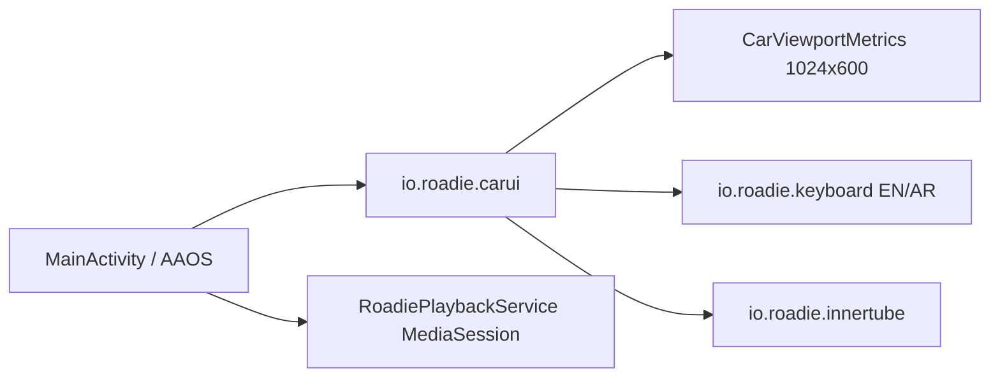

# Roadie Architecture

## Design Principles

1. **Zero APK patching:** Unlike iOS tweaks that swizzle readable Objective-C selectors, YouTube on Android is R8-obfuscated on every release. Roadie uses a clean-room InnerTube client + Media3 so releases never break on app updates.
2. **Logical car viewport (`CarViewportMetrics`):** Mirrors a `1024×600` logical floor, `>= 780dp` 3-column browse grid, and `>= 820dp` wide split-watch layout.
3. **Self-contained bilingual car keyboard (`CarTouchKeyboard`):** Provides large-target English and Arabic input without relying on the head unit's system IME.
